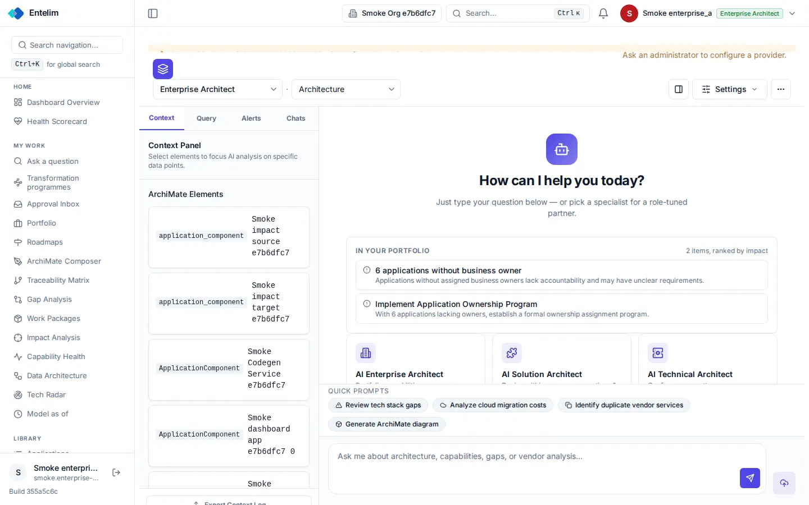
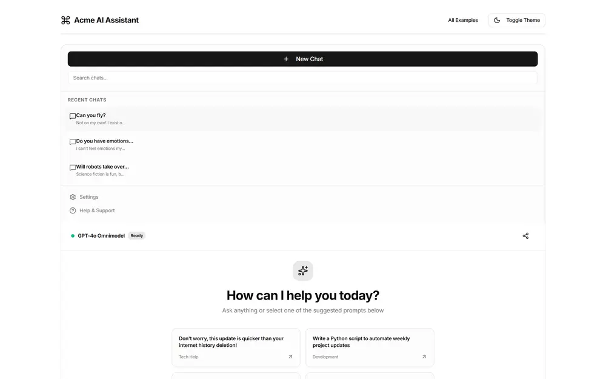

# AI chat - redesign spec

Block: Chat. Follows shadcn examples: playground (https://ui.shadcn.com/examples/playground) and the flask-basecoat example 'AI chat'.

## Job
A person asks the assistant a question and gets a sourced answer.

## Side by side
| Today (1440 wide, signed in as a seeded architect) | Reference (flask-basecoat 'AI chat') |
|---|---|
|  |  |

## What moves
- The three-panel layout becomes two: the conversation in the middle and a context sheet that opens on demand; the Context panel no longer fills the left third at 1440 wide.
- The warning strip is clipped behind the toolbar; it becomes an alert above the conversation.
- Context cards no longer print raw type names such as 'application_component' in code font; they show the element's type as a badge.
- The persona cards at the bottom of the empty conversation are no longer cut off by the prompt chips; the chips sit directly above the input.
- At 390 wide the input stays visible and the context sheet is a full-width drawer.

## What merges
- The Settings menu and the three-dot menu both hold settings; merge them.

## What is removed
- Nothing is hidden.

## States
- Empty: The empty conversation keeps the greeting and shows at most four starter prompts.
- Loading: The reply streams in, with a stop button.
- Error: A failed reply shows an error row with Retry; the question stays.

## Journey that proves it
An architect types a question, receives an answer with sources, and each source link lands on the element it names.

Every control on the rebuilt page is a component from the shared library; no hand-written button, input, select, table or dialog, no raw colour, no shadow, no inline style. Judged at 1440 and 390 wide, light and dark.
