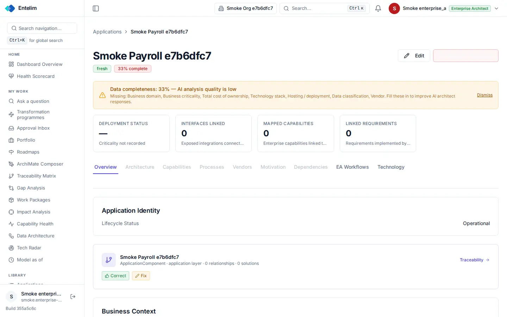
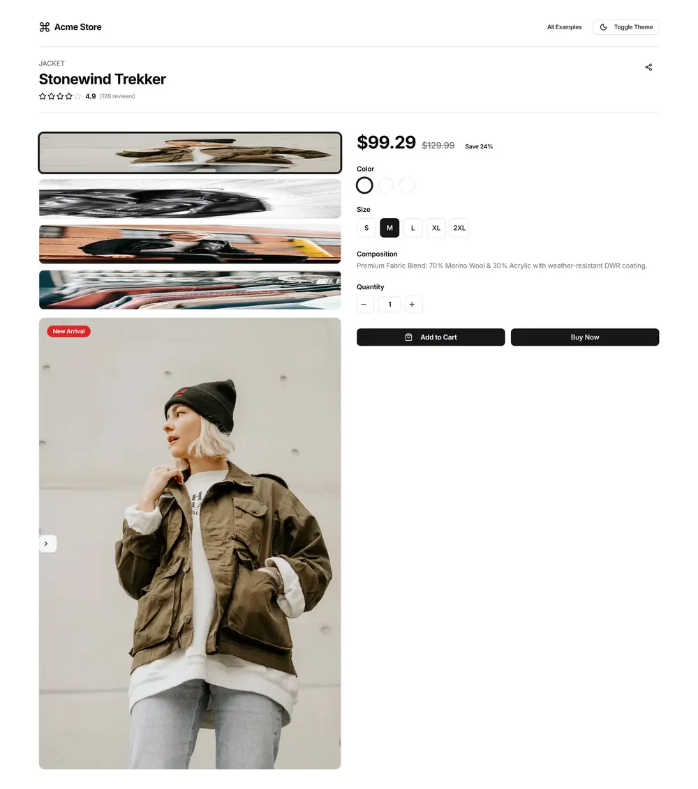

# Application - redesign spec

Block: Record detail. Follows shadcn examples: mail (reading pane) (https://ui.shadcn.com/examples/mail) and the flask-basecoat example 'product detail'.

## Job
A person understands one application and acts on it.

## Side by side
| Today (1440 wide, signed in as a seeded architect) | Reference (flask-basecoat 'product detail') |
|---|---|
|  |  |

## What moves
- The red button beside Edit renders with no label; it becomes a Delete button with its text, or moves into the page menu.
- The completeness warning moves below the tabs as a card, so the title, tabs and key figures read first.
- Four figure cards share one row and one height; 'Criticality not recorded' reads 'Not recorded' with an Add link.
- Tabs that cannot be used today (greyed) show a count or are removed; a greyed tab with no reason is not allowed.
- Lifecycle status sits in a two-column detail list inside a card, not a one-row card.

## What merges
- The identity card and the ArchiMate element card show the same name; merge them into one header card with a link to the element.

## What is removed
- Nothing is hidden.

## States
- Empty: A tab with no records shows an empty state that names what is missing and how to add it.
- Loading: Each tab shows a skeleton on first open.
- Error: A tab that fails shows an inline error with Retry.

## Journey that proves it
An application manager opens an application from the list, sees the same name, opens Capabilities and sees what is mapped or an empty state with a Map button.

Every control on the rebuilt page is a component from the shared library; no hand-written button, input, select, table or dialog, no raw colour, no shadow, no inline style. Judged at 1440 and 390 wide, light and dark.
