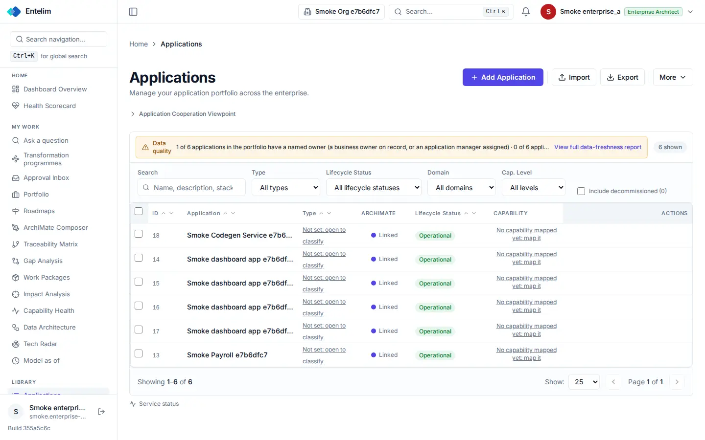
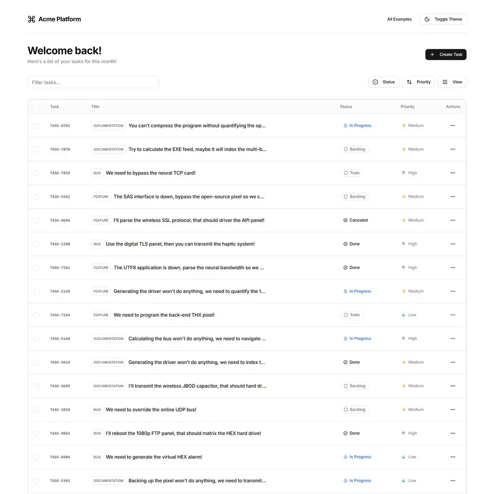

# Applications list - redesign spec

Block: Data table. Follows shadcn examples: tasks (https://ui.shadcn.com/examples/tasks) and the flask-basecoat example 'tasks'.

## Job
A person finds an application, sees which need attention, and opens one.

## Side by side
| Today (1440 wide, signed in as a seeded architect) | Reference (flask-basecoat 'tasks') |
|---|---|
|  |  |

## What moves
- Search, Type and Lifecycle become one toolbar row above the table with a Columns menu and a Filters popover for the rest, as in the reference.
- The Actions column header is empty and the row actions are missing in the capture; each row gets a row menu (Open, Edit, Delete).
- The Capability column's 'No capability mapped yet: map it' link becomes a badge with a Map button, not underlined body text.
- Names that are cut off with an ellipsis show the full name in a tooltip, and the Type column stops wrapping 'Not set: open to classify' over two lines.

## What merges
- The data-quality banner and the 6 shown pill state the same count; the pill goes.

## What is removed
- Nothing is hidden. The ArchiMate viewpoint expander moves to the page menu.

## States
- Empty: An empty portfolio shows an empty state: 'No applications yet', with Add application and Import buttons.
- Loading: The table shows five skeleton rows while loading.
- Error: A failed load shows an alert above the table with Retry.

## Journey that proves it
A portfolio manager filters to Operational, opens the first row and lands on that application's page showing the same name.

Every control on the rebuilt page is a component from the shared library; no hand-written button, input, select, table or dialog, no raw colour, no shadow, no inline style. Judged at 1440 and 390 wide, light and dark.
