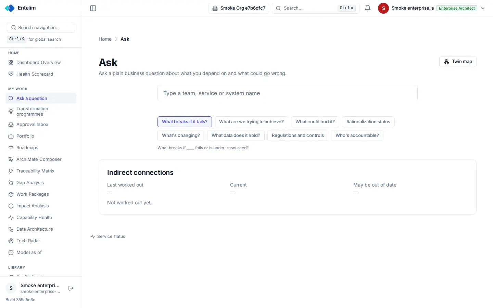

# Ask - redesign spec

Block: Chat. Follows shadcn examples: playground (https://ui.shadcn.com/examples/playground) and the flask-basecoat example 'AI chat'.

## Job
A person asks a plain business question and gets a cited answer.

## Side by side
| Today (1440 wide, signed in as a seeded architect) | Reference (flask-basecoat 'AI chat') |
|---|---|
|  |  |

## What moves
- The entry box becomes a chat input with a send button; the question chips sit above it as starter prompts.
- The answer appears as a message below the input with its sources listed, not in a card of three dashes.
- The hint under the chips ('What breaks if ___ fails ...') becomes the input's placeholder.
- Indirect connections moves into the answer as a table with last worked out, current and out-of-date counts.

## What merges
- Twin map in the header and the Indirect connections card point to the same map; keep the header button.

## What is removed
- Nothing is hidden.

## States
- Empty: Before the first question the page shows the greeting and the starter prompts; the three dashes become 'Not worked out yet' with a Work out button.
- Loading: While an answer is worked out a progress row shows.
- Error: A failed answer says what failed and keeps the question.

## Journey that proves it
A person picks 'What breaks if it fails?', types a system name, gets an answer listing dependent systems, and each name lands on that system's page.

Every control on the rebuilt page is a component from the shared library; no hand-written button, input, select, table or dialog, no raw colour, no shadow, no inline style. Judged at 1440 and 390 wide, light and dark.
