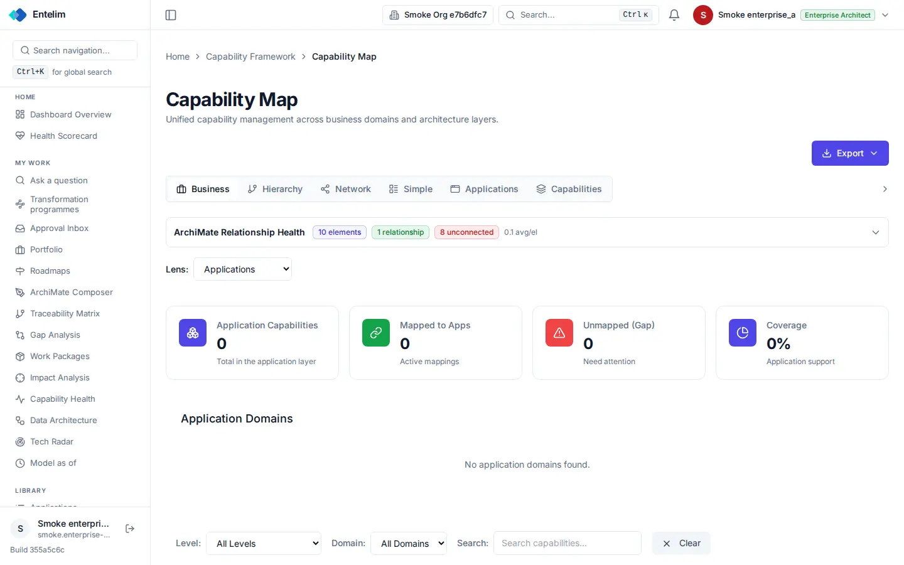
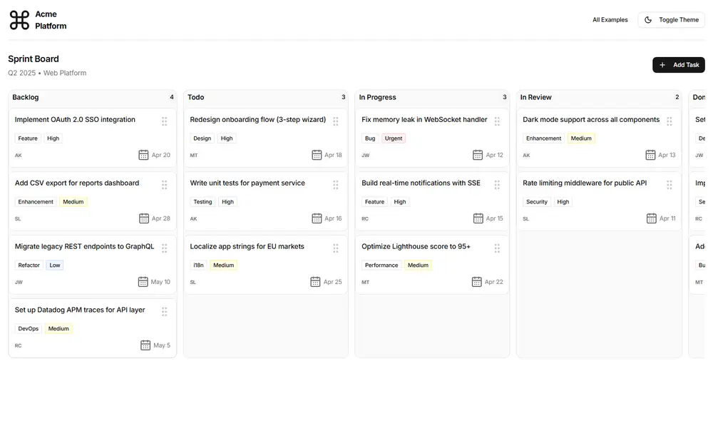

# Capability map - redesign spec

Block: Board. Follows shadcn examples: kanban in the component gallery (https://ui.shadcn.com/blocks) and the flask-basecoat example 'Kanban'.

## Job
A person sees what the company can do, which capabilities have gaps, and edits the map.

## Side by side
| Today (1440 wide, signed in as a seeded architect) | Reference (flask-basecoat 'Kanban') |
|---|---|
|  |  |

## What moves
- The six view tabs become a segmented control and the Lens select joins the same row.
- Level, Domain, Search and Clear move from the bottom of the page to the top toolbar, where a person looks for filters.
- The four figure cards drop to one line each; 0 and 0% with no data read as a dash with 'No capabilities mapped yet'.
- The relationship-health strip becomes an alert only when something is unconnected.

## What merges
- The Application Domains heading and the card above repeat the lens; keep the lens.

## What is removed
- Nothing is hidden.

## States
- Empty: 'No application domains found.' becomes an empty state with Add capability and Import buttons.
- Loading: Columns show skeleton cards while loading.
- Error: A failed load shows an alert with Retry.

## Journey that proves it
A business architect opens the map, filters to one domain, opens a capability and lands on its page showing the same name; an empty organisation sees the empty state with Add.

Every control on the rebuilt page is a component from the shared library; no hand-written button, input, select, table or dialog, no raw colour, no shadow, no inline style. Judged at 1440 and 390 wide, light and dark.
