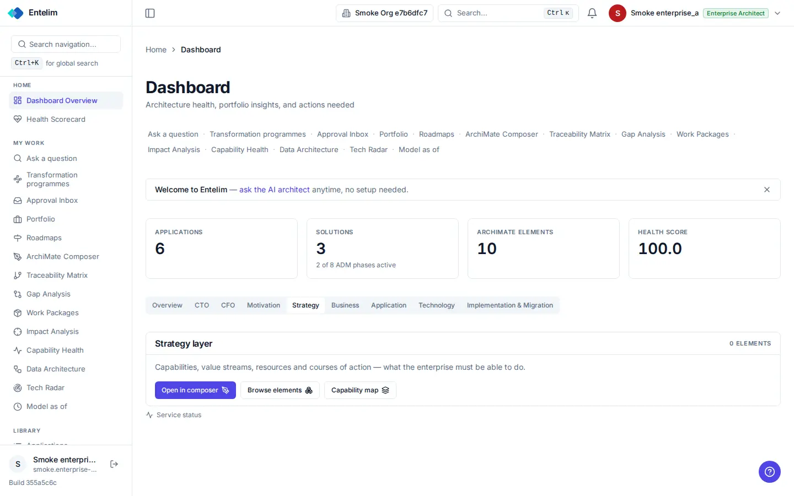
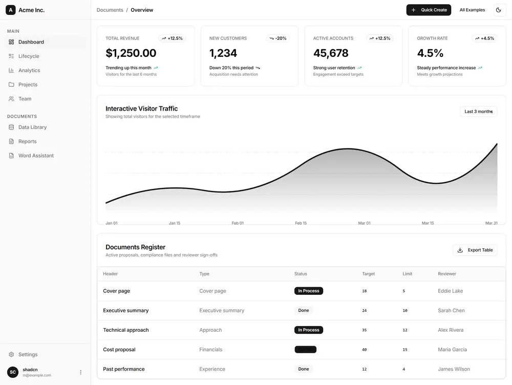

# Dashboard overview - redesign spec

Block: Dashboard. Follows shadcn blocks: dashboard-01 (https://ui.shadcn.com/blocks#dashboard-01) and the flask-basecoat example 'dashboard'.

## Job
A person sees the state of the estate and goes to what needs attention.

## Side by side
| Today (1440 wide, signed in as a seeded architect) | Reference (flask-basecoat 'dashboard') |
|---|---|
|  |  |

## What moves
- The two lines of link text under the title become a row of shortcut buttons or move to the sidebar, which already lists every destination.
- The four figure cards use one metric card with a delta line, as in the reference; Health score shows a dash with a reason when it cannot be computed.
- The layer tabs (Overview, CTO, CFO, Motivation ...) become a proper tab list; the active tab's panel shows a table or chart, not a card with three buttons.
- A layer with no elements shows an empty state that says why and offers Add or Import.

## What merges
- The welcome strip and the figure cards both introduce the product; keep the figure cards and show the welcome strip once, until dismissed.

## What is removed
- Nothing is hidden; the link rows are deleted because the sidebar holds them.

## States
- Empty: '0 elements' is replaced by an empty state with the next step.
- Loading: Each card shows a skeleton while its figure loads.
- Error: A failed figure shows an inline error with Retry in the card; the other cards stay.

## Journey that proves it
An architect opens the dashboard, sees Applications 6, clicks that card and lands on the applications list showing the same 6.

Every control on the rebuilt page is a component from the shared library; no hand-written button, input, select, table or dialog, no raw colour, no shadow, no inline style. Judged at 1440 and 390 wide, light and dark.
