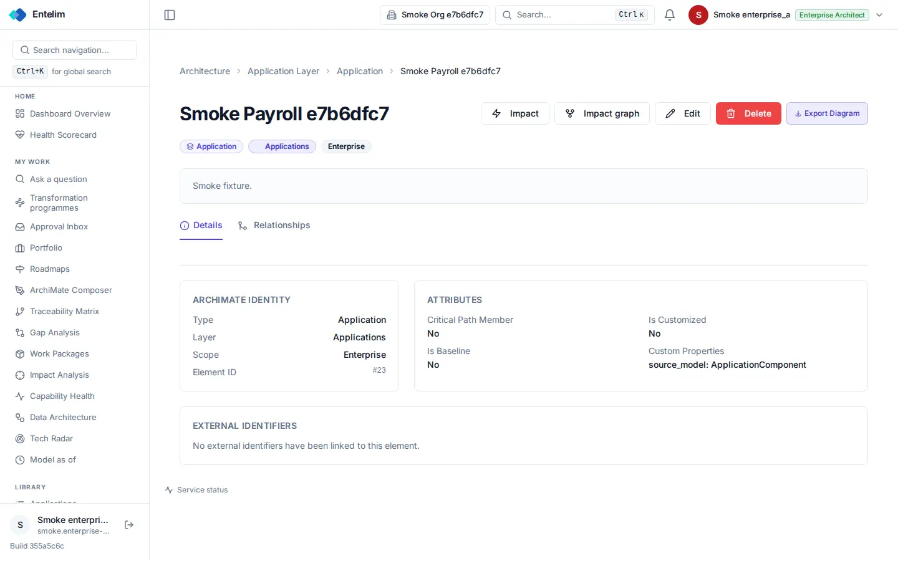

# Element page - redesign spec

Block: Record detail. Follows shadcn examples: mail (reading pane) (https://ui.shadcn.com/examples/mail) and the flask-basecoat example 'product detail'.

## Job
An architect reads one ArchiMate element and its relationships and changes it.

## Side by side
| Today (1440 wide, signed in as a seeded architect) | Reference (flask-basecoat 'product detail') |
|---|---|
|  |  |

## What moves
- Impact, Impact graph, Edit, Delete and Export Diagram collapse to Edit as the primary action and a menu for the other four.
- Delete leaves the main row and sits in the menu, behind a confirm dialog.
- The Details panel uses one detail list; 'Custom Properties' prints readable rows, not 'source_model: ApplicationComponent'.
- The Relationships tab shows a table with counts in the tab label.

## What merges
- The type badges (Application, Applications, Enterprise) repeat the identity card; keep the badges, drop the Type, Layer and Scope rows.

## What is removed
- Nothing is hidden.

## States
- Empty: No external identifiers: the card says so and offers Link identifier.
- Loading: Tab content shows a skeleton on first open.
- Error: A failed delete shows an error toast and leaves the page unchanged.

## Journey that proves it
An architect opens an element from the list, sees its relationships, and every relationship link lands on the other element's page.

Every control on the rebuilt page is a component from the shared library; no hand-written button, input, select, table or dialog, no raw colour, no shadow, no inline style. Judged at 1440 and 390 wide, light and dark.
