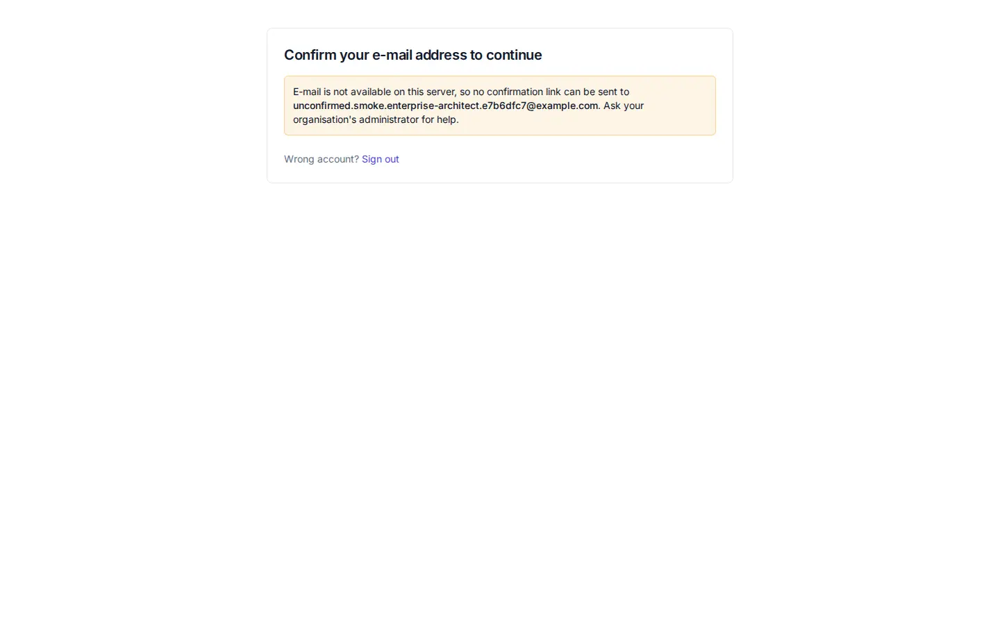
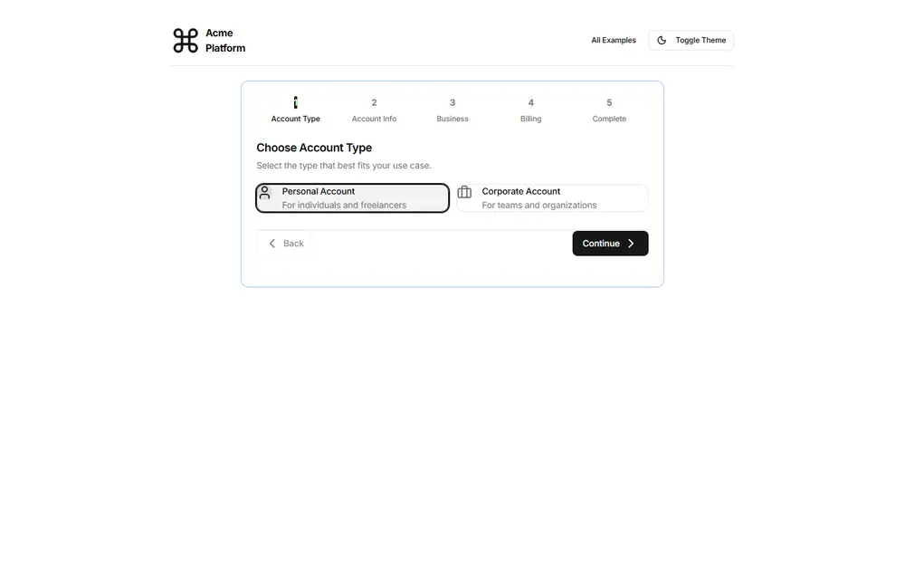

# First screen after sign-up - redesign spec

Block: Onboarding. Follows shadcn examples: authentication (confirmation step) (https://ui.shadcn.com/examples/authentication) and the flask-basecoat example 'onboarding'.

## Job
A person who just signed up knows exactly what to do next.

## Side by side
| Today (1440 wide, signed in as a seeded architect) | Reference (flask-basecoat 'onboarding') |
|---|---|
|  |  |

## What moves
- The message sits in the same centred card as Sign up, with a step indicator showing step 2 of 3 (Account, Confirm, Start).
- When email cannot be sent, the notice says what the person can do next: a button to contact their organisation's administrator and a link to continue once confirmed.
- Sign out becomes a ghost button, not an inline link.

## What merges
- None.

## What is removed
- Nothing is hidden.

## States
- Empty: Not applicable.
- Loading: Resend shows a spinner and then a confirmation toast.
- Error: If sending fails, the card says so and keeps the Resend button available; it does not claim a link was sent.

## Journey that proves it
A new person lands here after sign-up, sees the address the link was meant for, and either confirms or signs out and returns to Sign in.

Every control on the rebuilt page is a component from the shared library; no hand-written button, input, select, table or dialog, no raw colour, no shadow, no inline style. Judged at 1440 and 390 wide, light and dark.
