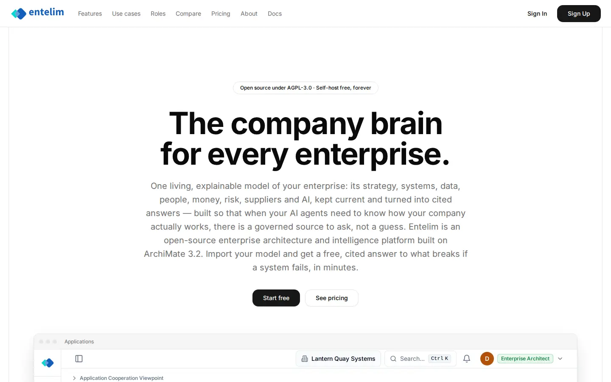
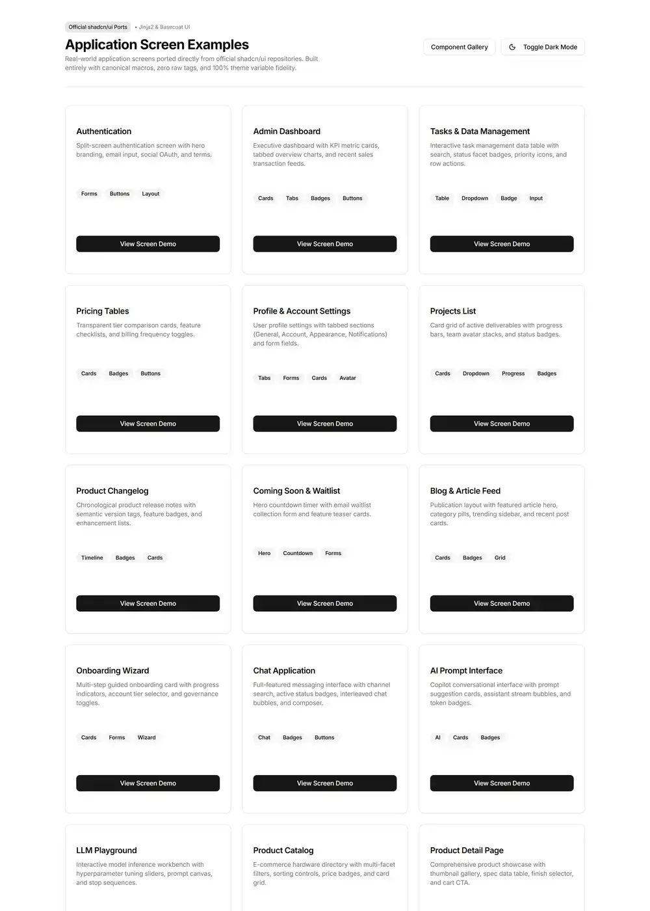

# Home - redesign spec

Block: Public page. Follows shadcn site home (https://ui.shadcn.com) and the flask-basecoat example 'home'.

## Job
A visitor decides in one screen what Entelim is and starts free.

## Side by side
| Today (1440 wide, signed in as a seeded architect) | Reference (flask-basecoat 'home') |
|---|---|
|  |  |

## What moves
- The 600-character introduction paragraph shortens to two sentences under the headline; the rest moves to the Features page.
- The product screenshot moves up so it appears beside or just under the two buttons at 1440 wide, not below the fold.
- Start free is the only filled button; See pricing becomes an outline button, as in the reference.

## What merges
- The open-source badge and the footer licence line say the same thing; keep the badge only.

## What is removed
- Nothing is hidden; the long paragraph is moved to Features rather than collapsed.

## States
- Empty: Not applicable: the page has no data. If the product screenshot fails to load, show the card frame with its caption instead of a broken image.
- Loading: The page is static; nothing loads after the first paint.
- Error: Not applicable: no form on this page. Both buttons go to pages that exist (Sign up and Pricing).

## Journey that proves it
A visitor reads the headline, clicks Start free and lands on the sign-up form; clicks See pricing and lands on the plans.

Every control on the rebuilt page is a component from the shared library; no hand-written button, input, select, table or dialog, no raw colour, no shadow, no inline style. Judged at 1440 and 390 wide, light and dark.
