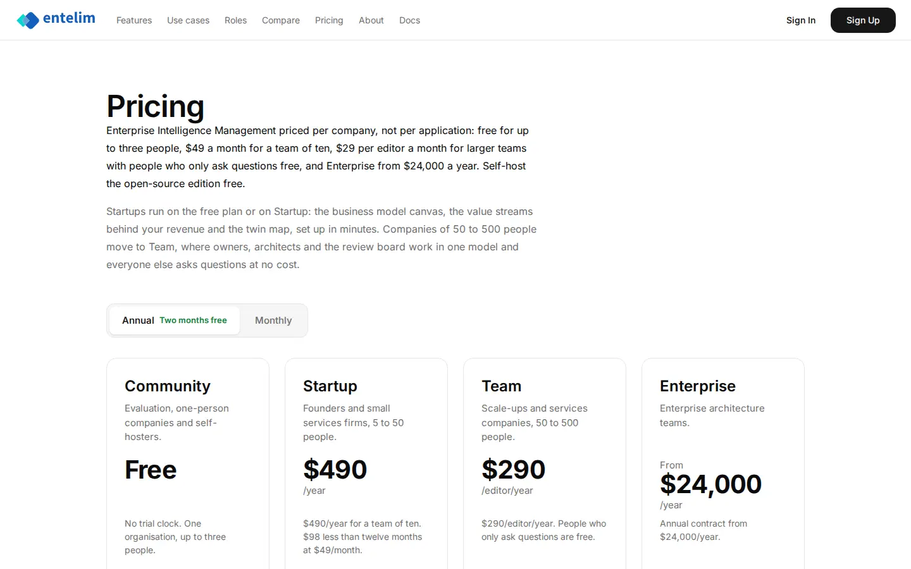
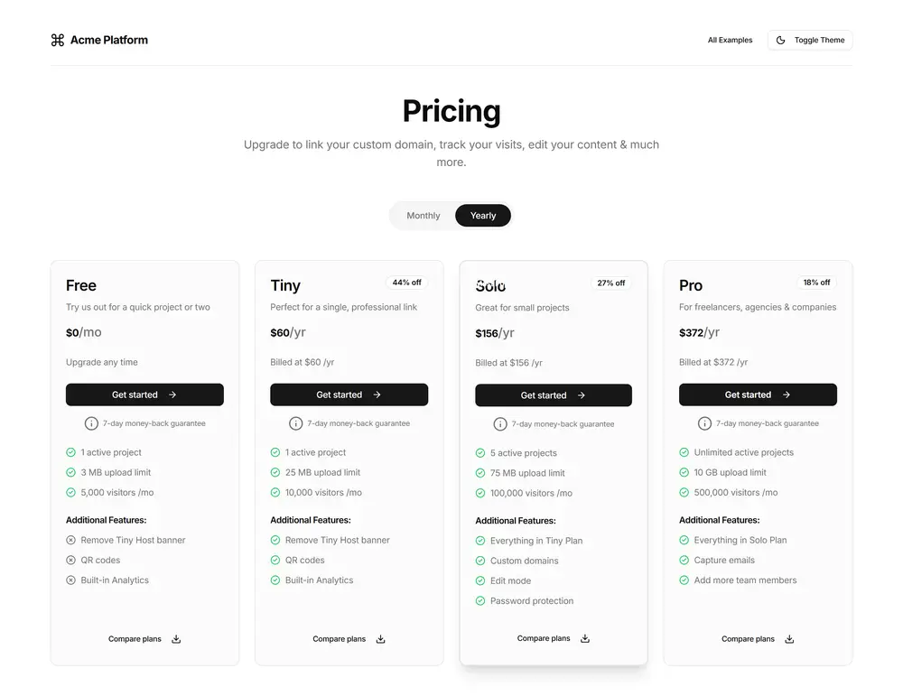

# Pricing - redesign spec

Block: Public page. Follows shadcn site home (pricing section) (https://ui.shadcn.com) and the flask-basecoat example 'pricing'.

## Job
A buyer finds the plan that fits their company and starts it.

## Side by side
| Today (1440 wide, signed in as a seeded architect) | Reference (flask-basecoat 'pricing') |
|---|---|
|  |  |

## What moves
- The page title and the two intro paragraphs sit in one centred header block; today the title touches the paragraph with no gap.
- The Annual / Monthly switch moves under the header and centres over the plan cards.
- The four plan cards share one height; the price, the per-unit line and the button align across cards.
- Each card's repeated price sentence (for example the yearly price said again under the price) is removed; the figure appears once.

## What merges
- The plan comparison table and the card feature lists show the same features; keep the table and shorten each card to four lines.

## What is removed
- Nothing is hidden; repeated price sentences are deleted.

## States
- Empty: Not applicable: prices come from the plan definition. If a price is missing show a dash and 'Contact us', never zero.
- Loading: Static; the switch changes figures without a reload.
- Error: Not applicable: no form. Each plan button lands on sign-up with that plan chosen.

## Journey that proves it
A buyer switches to Monthly, sees every figure change, clicks Start on Startup and lands on sign-up showing the Startup plan.

Every control on the rebuilt page is a component from the shared library; no hand-written button, input, select, table or dialog, no raw colour, no shadow, no inline style. Judged at 1440 and 390 wide, light and dark.
