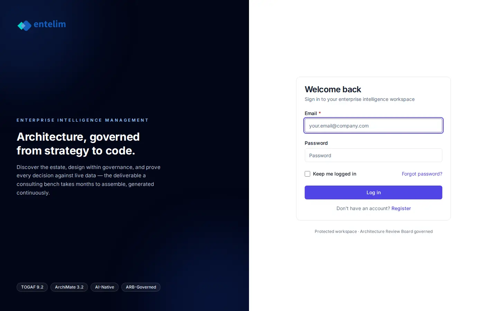

# Sign in - redesign spec

Block: Onboarding. Follows shadcn blocks: login-04 (https://ui.shadcn.com/blocks#login-04) and the flask-basecoat example 'authentication'.

## Job
A returning person signs in and reaches their dashboard.

## Side by side
| Today (1440 wide, signed in as a seeded architect) | Reference (flask-basecoat 'authentication') |
|---|---|
|  |  |

## What moves
- Heading and subtitle move into a card header; the form fields use the shared input macro with the same height as Sign up.
- Forgot password sits on the password label's row, as in the reference.
- The brand panel's four badges move under the paragraph so they never collide with the footer at 390 wide, where the panel collapses above the form.

## What merges
- Shares the auth layout with Sign up.

## What is removed
- Nothing is hidden.

## States
- Empty: Not applicable.
- Loading: The Log in button shows a spinner and is disabled while the request runs.
- Error: A wrong password shows one alert above the form, 'Email or password is not right', with the email kept.

## Journey that proves it
A returning person signs in and lands on the dashboard; a wrong password keeps them on this page with the alert.

Every control on the rebuilt page is a component from the shared library; no hand-written button, input, select, table or dialog, no raw colour, no shadow, no inline style. Judged at 1440 and 390 wide, light and dark.
