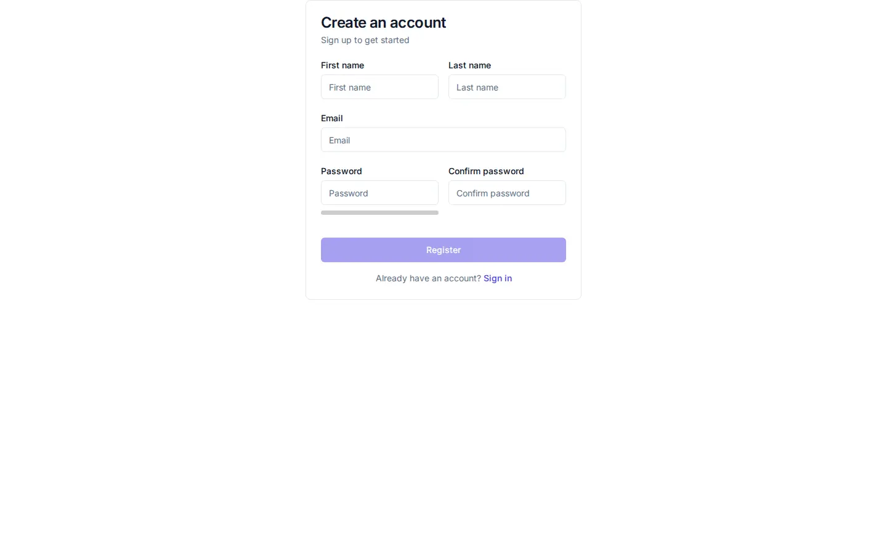
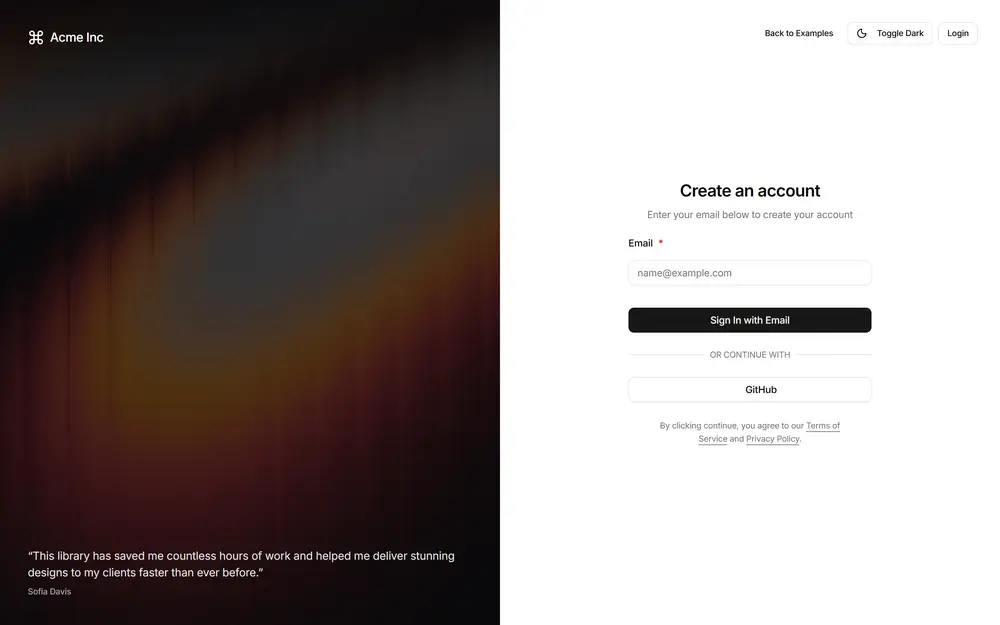

# Sign up - redesign spec

Block: Onboarding. Follows shadcn blocks: login-04 / authentication example (https://ui.shadcn.com/blocks#login-04) and the flask-basecoat example 'authentication'.

## Job
A new person creates an account in under a minute.

## Side by side
| Today (1440 wide, signed in as a seeded architect) | Reference (flask-basecoat 'authentication') |
|---|---|
|  |  |

## What moves
- The form card sits in the vertical middle of the screen, not jammed against the top edge.
- The page takes the same two-column layout as Sign in: brand panel on one side, form on the other.
- The password strength bar gets a label (Weak, Fair, Strong) and sits under the field it measures, with the same width as Confirm password.

## What merges
- Sign in and Sign up share one auth layout; the two pages stop carrying separate copies of the card and the footer link.

## What is removed
- Nothing is hidden.

## States
- Empty: Not applicable.
- Loading: The Register button shows a spinner and is disabled while the request runs.
- Error: Each field error appears under its field in plain words (for example 'That email is already registered. Sign in instead.'), with the form values kept.

## Journey that proves it
A new person fills the form, submits, and lands on the first screen after sign-up with their email shown.

Every control on the rebuilt page is a component from the shared library; no hand-written button, input, select, table or dialog, no raw colour, no shadow, no inline style. Judged at 1440 and 390 wide, light and dark.
